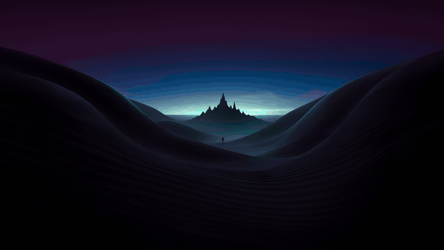
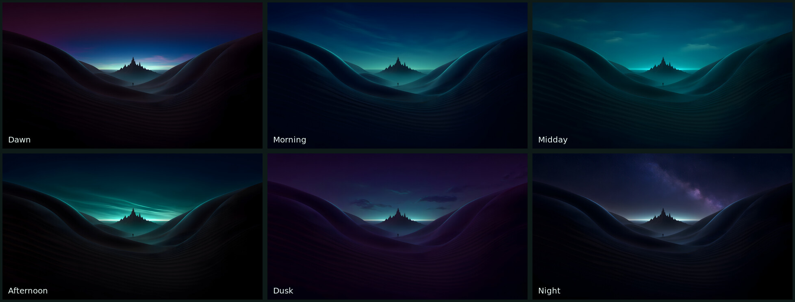

# Dunes – Time of Day

A dark, minimalist time-of-day wallpaper for GNOME: six 4K images (3840×2160) of the same dune valley whose light and sky change over the day, with slow 30-minute crossfades between them.





## Schedule

| Image | Time |
|---|---|
| Dawn | 05:00–08:00 |
| Morning | 08:00–11:00 |
| Midday | 11:00–15:00 |
| Afternoon | 15:00–18:00 |
| Dusk | 18:00–21:00 |
| Night (Milky Way) | 21:00–05:00 |

The same schedule applies to both the light and the dark style.

## Install

```sh
tar xzf dunes-time-of-day-*.tar.gz
cd dunes-time-of-day
./install.sh --set
```

Without `--set` the wallpaper is only installed; pick "Dunes – Time of Day" under Settings → Appearance → Background.

Files go to `~/.local/share/backgrounds/dunes-time-of-day/` and `~/.local/share/gnome-background-properties/`. Remove them with `./uninstall.sh`.

## Made with AI

The images were generated with the open-weight model Qwen-Image 2.1 in ComfyUI and upscaled with Real-ESRGAN. The time-of-day variants are edits of a single base image (using the Qwen-Image 2.1 Consistency LoRA), so the landscape stays aligned during the crossfades.

## License

[CC0 1.0 Universal](LICENSE) – public domain, free for any use.
